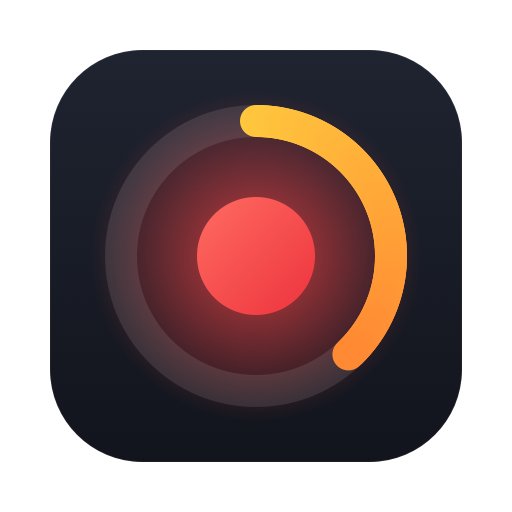
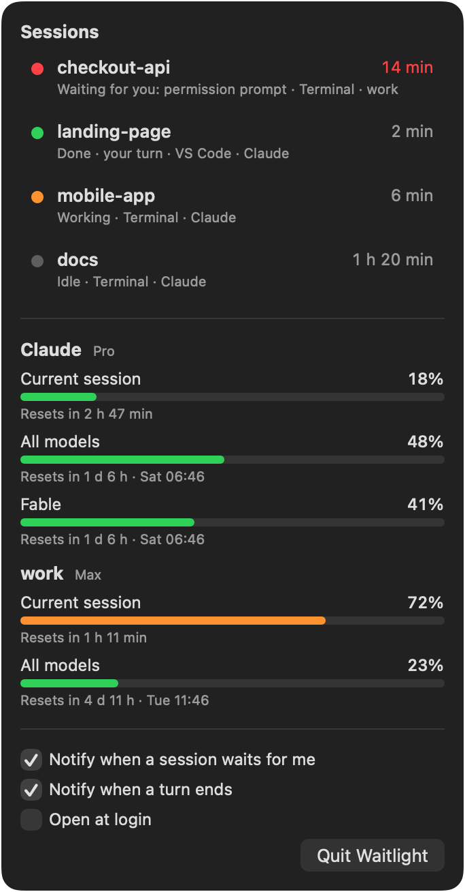

<p align="center">
  
</p>

<h1 align="center">Waitlight</h1>

<p align="center">
  A macOS menu bar app that shows when Claude Code is waiting for you, and how much of your Claude plan is left.
</p>

<p align="center">
  <a href="https://github.com/falconsw/Waitlight/releases/latest"></a>
  
  <a href="LICENSE"></a>
</p>

<p align="center">
  
</p>

You start a task in Claude Code, switch to another window, and come back twenty
minutes later to find it stopped after one minute to ask for permission.
Waitlight puts that wait in the menu bar: a red dot and how long the session
has been waiting, `● 14 min`. Click it, click the session, and you are back in
its terminal tab.

## Features

**Sessions**
- The menu bar shows a red dot while a session waits for you, with how many
  are waiting and the longest wait; green when a turn has finished and you
  have not looked yet; amber while sessions are working.
- The panel lists every open Claude Code session: waiting, done, working or
  idle, and for how long.
- Click a session to go back to it. Terminal.app and iTerm2 select the exact
  tab; VS Code, Cursor and Windsurf raise the window with that folder; any
  other terminal is brought to the front.
- A notification when a session has waited more than ten seconds, and when a
  turn ends while you are in another app. Each can be switched off.

**Claude usage**
- The current session (5-hour) window, the weekly window for all models, and
  the weekly window of a model your plan meters on its own, each with when it
  resets. The menu bar shows the 5-hour figure.
- More than one Claude account: a second login kept in `~/.claude-<name>`
  (run with `CLAUDE_CONFIG_DIR=~/.claude-<name> claude`) gets its own sessions
  and its own limits in the same panel.

**Nothing to set up**
- No hooks, no plugin, nothing added to Claude Code's settings. Session state
  is read from the files Claude Code already writes under `~/.claude/sessions`.
- No passwords. Usage is read with the sign-in Claude Code keeps in your login
  keychain, which is read and never written.
- English and Turkish, following the system language.

## Requirements

macOS 15 or later, and Claude Code.

## Install

With [Homebrew](https://brew.sh):

```sh
brew install --cask falconsw/tap/waitlight
```

Or download the DMG from the [latest release](https://github.com/falconsw/Waitlight/releases/latest)
and drag Waitlight to Applications.

The first time you click a session that runs in Terminal or iTerm2, macOS asks
whether Waitlight may control that terminal. It is used only to select the tab.

To update: `brew upgrade --cask waitlight`. To remove: `brew uninstall --cask waitlight`.

## Build

Needs Xcode and [XcodeGen](https://github.com/yonaskolb/XcodeGen).

```sh
make run     # build and open
make test
```

## Credits

The session reading and window focusing come from
[Leftover](https://github.com/falconsw/Leftover), itself a fork of
[codenotch](https://github.com/vinzdg/codenotch) by Vinz.

## License

MIT
